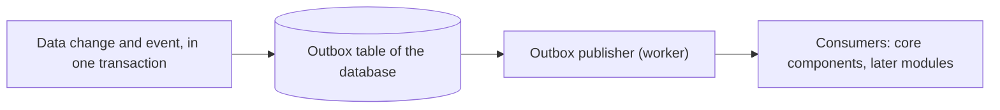

# Domain events

This file gives the rules for the domain events of the core components and the modules.
Terms follow the [glossary](../glossary.md).
[ADR 0018](../decisions/0018-domain-events-and-outbox.md) gives the reasons for the outbox.

## Flow of an event



1. A core component changes its data and writes the event to the outbox, in the same transaction.
2. The outbox publisher in the worker reads the new events of each database.
3. The publisher sends each event to the consumers that accept its name and its version.
4. When all the consumers succeed, the publisher marks the event as published.

## Event names

The name of an event has three parts: `<component>.<entity>.<verb in the past tense>`.

| Part | Rule | Example |
| --- | --- | --- |
| Component | The core component or the module, in lowercase | `accounts`, `decks`, `mod_example` |
| Entity | The entity that changed, in lowercase, with words separated by underscores | `account`, `deck_version` |
| Verb | What happened, in the past tense | `created`, `deleted`, `email_checked` |

Examples: `accounts.account.created`, `decks.deck_version.created`.

## Versions

Each event type has a version number, from 1.

- Increase the version when a change to the payload can break a consumer: a removed field, a renamed field or a different meaning.
- Keep the version when you add an optional field.
- When the version increases, the producer writes the new version only. Update the consumers in the same pull request.
- Modules must accept the versions that they know, and ignore the others.

## Declare an event

An event is a C# record with the attribute `DomainEvent`:

```csharp
[DomainEvent("accounts.account.created", 1)]
public sealed record AccountCreated(Guid AccountId, string Language) : IDomainEvent;
```

- The payload is JSON with camel case names, as in the public API.
- Put only identifiers and the facts of the change in the payload. Never put a password, a token or a secret.
- Write the event with `IDomainEventWriter.WriteAsync`, in the transaction of the change.
- Give the owner of the data, when the data has an owner.

## Catalog of the event types

This table lists the event types and the versions that modules can consume.
The internal API gives the same list at `GET /internal/v1/events/types` ([internal API](internal-api.md)).
The API makes the list from the `DomainEvent` attributes of the core components.
A test compares the list with this table, so a new event type must come with a new row.
When the test fails, it gives the correct table.

<!-- event-catalog:start -->
| Type | Version | Payload |
| --- | --- | --- |
| `accounts.account.created` | 1 | `accountId` (uuid), `language` (string), `shard` (string), `createdAt` (date-time) |
| `accounts.account.deleted` | 1 | `accountId` (uuid) |
| `cards.card_data.imported` | 1 | `source` (string), `changedCards` (integer), `changedPrintings` (integer), `deletedPrintings` (integer) |
| `decks.deck.created` | 1 | `deckId` (uuid), `format` (string), `visibility` (string), `sourceDeckId` (uuid or null) |
| `decks.deck.deleted` | 1 | `deckId` (uuid) |
| `decks.deck.updated` | 1 | `deckId` (uuid), `version` (integer), `format` (string), `visibility` (string) |
<!-- event-catalog:end -->

Each event also has an envelope with the event ID, the type, the version, the owner ID and the time of the change.

## Consume an event

A consumer implements `IDomainEventConsumer`:

- `Accepts(type, version)` tells which events the consumer receives.
- `HandleAsync(event)` processes one event.

A core component registers its consumers in `AddWorkerServices`.

Rules for the consumers:

- A consumer can receive an event two times. Use the identifier of the event to ignore a copy.
- The order of the events can change after a failure. Do not depend on the order.
- An exception makes the publisher try again later: after 2 seconds, then 4, 8 and more, with one hour at most.
- After 10 failures, the event stays in the outbox with its last error, and the publisher stops sending it.

## Outbox tables

| Database | Table |
| --- | --- |
| Users database | `users.outbox` |
| Reference database | `reference.outbox` |
| Each shard database | `content.outbox` |

The publisher deletes the published events after 7 days (`Outbox:Retention`).
