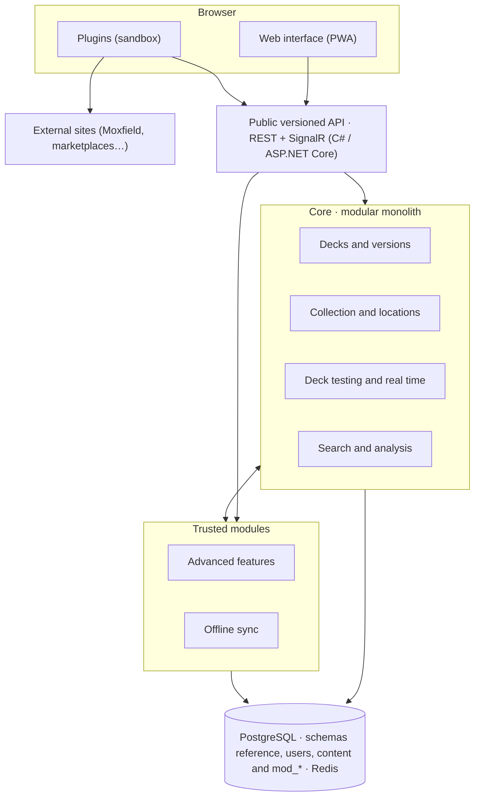

# Architecture overview

This file gives the architecture of Reliquary: the parts of the system, the core components, the principles and the extensions.
Terms follow the [glossary](../glossary.md).

## Parts of the system

Plugins stay in the browser.
Modules also run on the server, and they use the database.
This diagram shows the parts of Reliquary and their connections.

- The web interface and the plugins call the public API.
- Plugins can also call external sites, for example Moxfield or marketplaces.
- The public API calls the core and the trusted modules.
- The core and the modules communicate in both directions.
- The core and the modules use PostgreSQL and Redis.
  PostgreSQL contains the schemas `reference`, `users` and `content`, and one `mod_<id>` schema for each module.

## Core components

The core is a modular monolith with five core components.
Each core component owns its tables.
A core component communicates with other core components only through interfaces and domain events.
It never reads or writes the tables of another core component.
[ADR 0007](../decisions/0007-modular-monolith.md) gives the reasons.

| Core component | Content | Name in the diagram |
| --- | --- | --- |
| Accounts | Accounts, authentication, API keys, quotas, service accounts and delegation tokens, in the `users` schema | Not in the diagram |
| Cards | Card reference data, card search and deck analysis | Search and analysis |
| Decks | Decks, deck versions, variants, tags and folders | Decks and versions |
| Collection | Locations, location entries, movements and inventories | Collection and locations |
| Playtest | The table engine and the game sessions of online games | Deck testing and real time |

## Principles

### API first

The web interface uses the same public API as the plugins and the third-party clients.
The public API uses REST and SignalR, and it has a version number.

### Stateless API

The API keeps no session in memory.
Each request carries an authentication token.
Any replica of the API can serve any request.

### Real time

Each online game uses a game session with SignalR.
A Redis backplane connects the replicas of the API, so that the players of one game session can use different replicas.

### Background workers

Background tasks run in worker processes, separate from the API.
Examples are the Scryfall synchronization, auto-tag and the tasks of modules.
The workers scale independently of the API.

### Extension boundary

The core never runs plugin code on the server.
Only signed modules that the instance administrator installs run on the server.

## Extensions

Reliquary has two levels of extensions:

- A **plugin** runs only in the browser, in a sandbox.
  Anyone can write a plugin, and each user installs plugins for their own account.
- A **module** is a trusted extension with a front-end part and a server part.
  Only the instance administrator can install a module.
  A module can add its own tables.

Plugins arrive in milestone M4.
Modules come after M4, but the core prepares for them from milestone M0.
The [extensions](./extensions.md) file gives the details.

## Related documents

- [Data model](./data-model.md): the card reference data and the user data
- [Database](./database.md): the schemas, the shard directory, the move of a user and the migrations
- [Extensions](./extensions.md): plugins and modules
- [Technology stack](./tech-stack.md): the technologies, the performance targets and the scaling
- [Roadmap](../roadmap.md): the milestones and their gates
- [Decision records](../decisions/README.md): the reasons for the decisions
