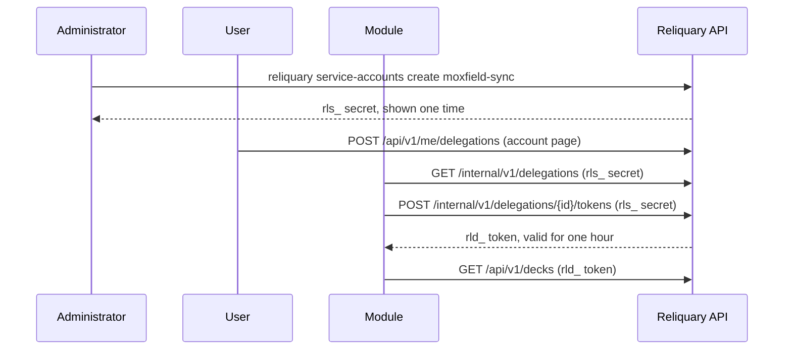

# Service accounts and delegations

This page tells how a module authenticates and how it acts for a user.
Terms follow the [glossary](../glossary.md).
[ADR 0037](../decisions/0037-service-accounts-and-delegation-tokens.md) gives the reasons for the design.

## Credentials

| Credential | Format | Who has it | Where it works |
| --- | --- | --- | --- |
| Service account secret | `rls_<prefix>_<secret>` | A module | The [internal API](internal-api.md) |
| Delegation token | `rld_<prefix>_<secret>` | A module, for one user | The endpoints of the public API that declare a scope |

Send each credential in the header `Authorization: Bearer`.
The database stores only the prefix and a SHA-256 hash of the secret.

## Flow



1. The administrator creates a service account for the module and gives the secret to the module.
2. The user opens the account page and gives a delegation to the module: the scopes and the duration.
3. The module lists its delegations with `GET /internal/v1/delegations`.
4. The module asks for a delegation token with `POST /internal/v1/delegations/{id}/tokens`.
5. The module calls the public API with the delegation token. The API acts as the user, with the scopes of the token only.
6. Before the token expires, the module asks for a new token.

## Service accounts

The administrator manages the service accounts with the CLI or with the admin API.

```shell
reliquary service-accounts create moxfield-sync --description "Synchronizes your decks with Moxfield."
reliquary service-accounts list --all
reliquary service-accounts revoke moxfield-sync
```

| Endpoint | Credential | Effect |
| --- | --- | --- |
| `GET /api/v1/admin/service-accounts` | Access token of an administrator | Lists all the service accounts, also the revoked service accounts. |
| `POST /api/v1/admin/service-accounts` | Access token of an administrator | Creates a service account. The response contains the secret one time only. |
| `DELETE /api/v1/admin/service-accounts/{id}` | Access token of an administrator | Revokes a service account and all its delegations. |

- The name has 3 to 50 lowercase letters, digits and hyphens, with a letter first. The users see the name and the description.
- A service account is not a user. The endpoints for users refuse its secret with the status 403.
- After a revocation, the secret and the delegation tokens of the service account get the status 401.

## Delegations

| Endpoint | Credential | Effect |
| --- | --- | --- |
| `GET /api/v1/service-accounts` | Access token | Lists the active service accounts. The user can give a delegation to each of them. |
| `GET /api/v1/me/delegations` | Access token | Lists the active delegations of the user. |
| `POST /api/v1/me/delegations` | Access token | Gives a delegation to a service account: `serviceAccountId`, `scopes` and `expiresInDays` (1 to 365, default 90). |
| `DELETE /api/v1/me/delegations/{id}` | Access token | Revokes a delegation. Its tokens stop working immediately. |
| `GET /internal/v1/delegations` | Service account secret | Lists the active delegations that the users gave to the service account. |
| `POST /internal/v1/delegations/{id}/tokens` | Service account secret | Gives a delegation token. The optional field `scopes` asks for fewer scopes than the delegation. |

- Only a web session can give or revoke a delegation. An API key and a delegation token cannot.
- An account has 20 active delegations at most. Above this limit, the API returns the error `delegation_limit`.
- The account page shows the delegations in the panel **Delegations** of the slot `account.page`.

## Delegation tokens

- A token is valid for one hour (`Auth:DelegationTokenLifetime`), and never after the end of its delegation.
- The API reads the token, its delegation and its service account for each request. Thus a revocation takes effect immediately.
- These requests get the status 401, also on a public endpoint:
  - a token that expired
  - a token of a delegation that expired or that the user revoked
  - a token of a revoked service account
- The quotas of the API keys do not apply to the delegation tokens.

## Scopes

An endpoint accepts a delegation token only when it declares a scope and the token has this scope.
Else the API returns the status 403 with the code `scope_missing`.

| Scope | Endpoints |
| --- | --- |
| `decks:read` | `GET /decks`, `GET /decks/tags`, `POST /decks/export`, `GET /decks/{id}`, `GET /decks/{id}/legality`, `GET /decks/{id}/export`, `GET /decks/{id}/analysis`, `GET /decks/{id}/text`, `GET /decks/{id}/auto-tag`, `GET /decks/{id}/recommendations`, `GET /deck-folders`, `GET /tags`, the `GET` endpoints of the versions and the variants, `POST /lists/compare` |
| `decks:write` | `POST /decks`, `POST /decks/group`, `POST /decks/import`, `PATCH /decks/{id}`, `DELETE /decks/{id}`, the endpoints of the deck lines, `POST /decks/{id}/copy`, `PUT /decks/{id}/text`, `POST /decks/{id}/auto-tag` |
| `decks:write` | `POST`, `PATCH` and `DELETE` on `/deck-folders`, `PATCH` and `DELETE` on `/tags` |
| `decks:write` | The `POST` endpoints of the versions and the variants, and `POST /decks/{id}/merge` |
| `collection:read` | The `GET` endpoints of `/collection`: locations, entries, settings, the global view, storage rules, movements and inventories |
| `collection:write` | The `POST`, `PUT`, `PATCH` and `DELETE` endpoints of `/collection` |
| `profile:read` | `GET /me` |

All the paths start with `/api/v1`.
The other endpoints refuse the delegation tokens, for example the public decks, the favorites, the extensions and the card search.
A module can call the public endpoints of the cards with no credential.

To give a scope to an endpoint, add `RequireScope` of `Reliquary.BuildingBlocks.Security`:

```csharp
group.MapGet("/{deckId:guid}", GetAsync)
    .WithName("GetDeck")
    .RequireScope(Scopes.DecksRead);
```

## Personal data

The export of an account lists its delegations in `account/account.json`: the service account, the scopes and the dates.
The deletion of an account deletes its delegations and their tokens ([ADR 0032](../decisions/0032-personal-data.md)).
