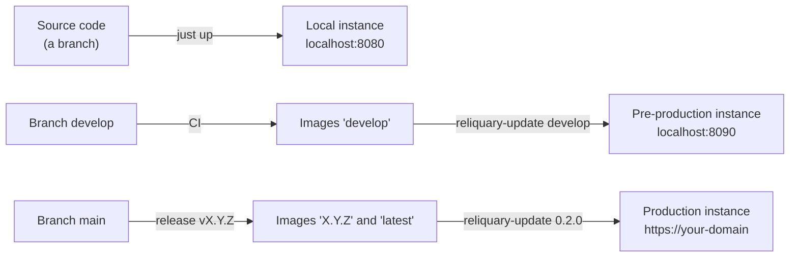

# Install and operate

This section tells how to install Reliquary, how to update it and how to keep its data.
Terms follow the [glossary](../glossary.md).

## Select a mode

| Mode | Use | Images | Data | Tool |
| --- | --- | --- | --- | --- |
| [Local instance](local-development.md) | Development and the tests of a branch | Built from the source code | Demo accounts and 342 demo cards. `just reset` deletes the data. | `just` |
| [Pre-production instance](pre-production.md) | Daily use on your computer, and the test of the next release with real data | Published images of the channel `develop` | Your accounts and all the cards. Each update keeps the data. | `reliquary-update`, or `reliquary-update.ps1` on Windows |
| [Production instance](production.md) | A server that other people use | Published images of a release | Your accounts and all the cards, with backups on a different computer | `reliquary-update`, or Kubernetes in a later version |

The three modes use the same code. A local instance and a pre-production instance can run on the same computer at the same time.

The three modes work on Linux and on Windows. The pages have a tab for each system. [Install the software](requirements.md#install-the-software) tells how to prepare the computer.

## Pages

| Page | Content |
| --- | --- |
| [Requirements](requirements.md) | The software, the hardware and the ports of each mode |
| [Local instance from the source code](local-development.md) | Install the development tools, start an instance, update it to a new commit |
| [Pre-production instance](pre-production.md) | Install the published images on your computer, update, roll back, back up |
| [Production instance](production.md) | Install on a server with HTTPS, a real email server and backups on a different computer |
| [Requirements for Kubernetes](kubernetes.md) | What a Kubernetes deployment must give to the images |
| [Versions and updates](versions-and-updates.md) | The channels, the release numbers, the steps of an update and the migration rules |
| [Troubleshooting](troubleshooting.md) | The usual problems and their solutions |
