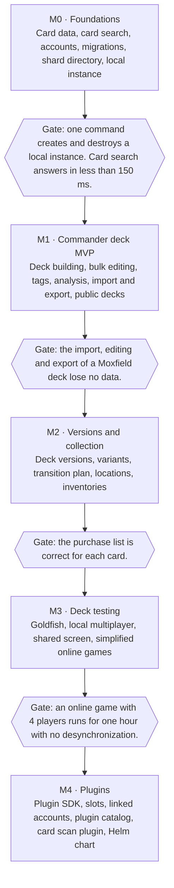

# Roadmap

This file gives the milestones of Reliquary, their content and their gates.
Terms follow the [glossary](./glossary.md).

The minimum viable product (MVP) is milestone M1.
It must already replace Moxfield for a Commander player.
Deck versions and the collection come next, then deck testing.
The plugin ecosystem opens last.

## Milestones and gates

The roadmap puts decks first, then the collection, deck testing and plugins.
It has five milestones, with a gate between each pair of milestones.
A sixth milestone, Later, contains the work after M4.

The [specification](./specification/README.md) gives the milestone of each feature.

## [M0: Foundations](https://github.com/nicolas-goyon/reliquary/milestone/1)

- Card data, with card faces and multiple card names
- Card search with the full Scryfall syntax
- Accounts, API keys and quotas
- SQL migrations and the shard directory
- A local instance

**Gate**: one command creates and destroys a local instance.
Card search answers in less than 150 ms.

## [M1: Commander deck MVP](https://github.com/nicolas-goyon/reliquary/milestone/2)

M1 is the main milestone.

- Deck building
- Bulk editing in text mode and in table mode
- Global tags and auto-tag
- Commander analysis and the needs of a deck
- Folders and duplication
- Import and export
- Public decks

**Gate**: Reliquary imports a Moxfield deck, the user edits it, and Reliquary exports it again with no data loss.

## [M2: Versions and collection](https://github.com/nicolas-goyon/reliquary/milestone/3)

- Deck versions, variants, comparison and transition plan
- Locked locations and locations that are not pickable
- Inventories
- Purchase preferences
- Differences between a deck and the available cards

**Gate**: the purchase list (the variant minus the available cards) is correct for each card.

## [M3: Deck testing](https://github.com/nicolas-goyon/reliquary/milestone/4)

- Goldfish
- Local multiplayer
- Table window and player window for screen sharing
- Simplified online games: linked boards, hidden information and no automated rules

**Gate**: an online game with 4 players runs for one hour with no desynchronization.

## [M4: Plugins](https://github.com/nicolas-goyon/reliquary/milestone/5)

- Browser plugins: the plugin SDK, interface slots, linked accounts, and the plugin catalog with checked and signed plugins
- A card scan plugin
- A Helm chart for Kubernetes

Server modules come after M4.

## [Later](https://github.com/nicolas-goyon/reliquary/milestone/6)

- Server modules
- Collection sharing
- The features with the priority v2 or later:
  - comments under a deck
  - deck co-editing
  - notifications
  - billing for the requests above the quota

## Rules

- Each gate is a criterion that a test can prove.
- Work on the next milestone starts after the gate passes.
- The public API, the routing by `owner_id` and the plugin structure exist from M0.
  But the plugin catalog opens only in M4.
